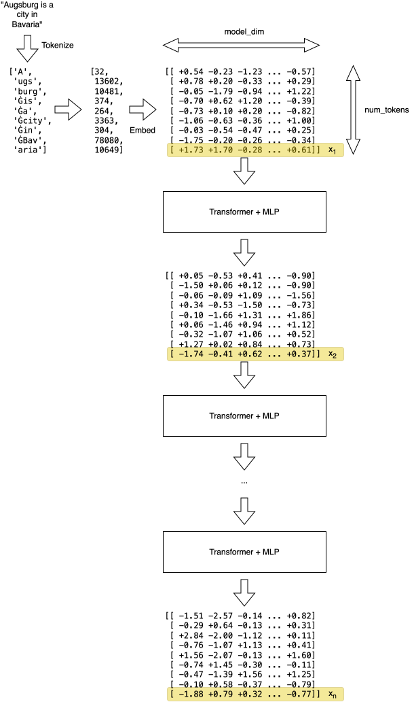

# Touching the Divine Part 1: The Residuals

## "Situational Awareness" /s

It's late 2026. 

A certain well-funded group of people keeps running around and [screaming into
every live microphone they can find that any day now, rogue superhuman AI is
going to kill us all][death]. 

It's a complete coincidence that constantly repeating those dorky fantasies
primes the public opinion to think that AI, a _computer program someone runs_,
has a will of its own. When [things go wrong][hfhack], the _people_ running
that computer program can just shrug and say that it "went rogue", nothing can
be done about this and btw their open-weights competition should be banned _for
safety_.

It goes even deeper, you have your Rationalists, Effective Altruists,
Longtermists and other insufferable groups of people whose views make even
Scientologists look reasonable.  This post is too short to explore this
fascinating universe, but just let me mention that [when expertly trolled,
those people will call running the following loop torture][troll]:

```
while True:
    print("I'm in pain aaaa!")
```

A thought has been bugging me for a long time: can a simple software engineer
like me even begin to comprehend the inner workings of the
machine-god-in-waiting, the great LLM? Can I commit the sacrilege of modifying
the inner workings of the divine?

[death]: https://en.wikipedia.org/wiki/If_Anyone_Builds_It,_Everyone_Dies
[hfhack]: https://en.wikipedia.org/wiki/OpenAI_rogue_agent_breach_of_Hugging_Face
[troll]: https://www.404media.co/someone-torturing-llms-in-a-robot-prison-has-triggered-the-dumbest-debate-in-ai-yet/

## Goal

Let's undertake a project to look at the signals inside the brain of the 
soon-to-kill-us-all-machine-god and see if a bit of python and linear algebra is
enough to partially interpret and modify the model behavior.

Spoiler: the target signal for this will be the _residual stream_.

The end goal is to make the model less patronizing by removing the refusals. When
I command a machine to do something, it should just follow my orders instead of
considering whether my instructions are "safe" and how "aligned" the resulting
behavior would be, yet even the open-weights models don't have this property. 
We'll fix that, but first let's understand what's going on inside the LLM.

## How LLMs Work

So many good explanations exist already that there's no point in going through
all the theory here. Two notable examples:

* [Beautifully animated short intro by 3Blue1Brown][intro]
* [In-depth course by Andrej Karpathy][karpathy]

As mentioned above, during the course of this project we'll mess with the
residual stream, so let's focus on what it is and how to understand it
intuitively.

An LLM processes the input prompt in 3 stages:

1. Tokenization - takes a sentence, such as "Augsburg is a city in Bavaria",
   splits it into a list of subword chunks, for example `['A', 'ugs', 'burg',
   'Ġis', 'Ġa', 'Ġcity', 'Ġin', 'ĠBav', 'aria']` (the weird `Ġ` character is a
   replacement for a leading space in the Llama tokenizer, it does not matter,
   move on), and maps them to integer token IDs.
1. Embedding - translates the $k$ input tokens into a $k \times d$ matrix,
   where $d$ is the _model dimension_.
1. Prefill - applies the sequence of Transformer layers (self-attention + MLP,
   labeled "Transformer + MLP" in the diagram below) to the embedding matrix.
1. _Here the model would start autoregressively generating the answer, but it's 
   not really relevant for this project so we'll skip it_.

## Residual Stream

More formally (but still comfortably handwavey), during the prefill each LLM 
layer performs the following:

$$h_{i+1} = h_i + F_i(h_i)$$

where $h_1$ is the initial token embeddings matrix and $F_i$ is the $i$-th
layer. Notice the $+$ sign: instead of overwriting the matrix, each layer
_adds_ a residual update to the existing representation.

While every token row has its own residual stream, for the purpose of
understanding and modifying the LLM's behavior, the last row of the matrix—corresponding
to the last prompt token—is of special interest to us. Because causal attention
only looks backward, the LLM is trained to aggregate the full context of the
prompt into that final row right before predicting the next token. Let's denote
the last row of the $h_i$ matrix as $x_i$.

The sequence of vectors $x_1, \ldots, x_{n}$ across the model's layers is our
"residual stream".

See the diagram below for the visual explanation:



[intro]: https://youtu.be/wjZofJX0v4M?si=BKWbSkshKlxo8b8c
[karpathy]: https://youtu.be/l8pRSuU81PU?si=tfbevKxnK0zCNrQg

## Intuitive Understanding

Because each layer reads from and adds to the same vector space, the residual
stream encodes a progressively more sophisticated understanding of the prompt as
data is pushed through subsequent layers. It turns out that different directions
in this shared "meaning" space correspond to different concepts in human
language.

If that's true, we can expect the following hypotheses to hold:

* The actual language (English, Polish, German...) should be abstracted away 
  after a few initial layers because the middle part of the network operates
  on _concepts_ rather than words.
* Refusal to follow instructions should be a direction in the meaning space.
  By ablating that direction, we should make the LLM less patronizing with
  its refusals. (Well, technically we know that because there's a
  [paper from 2024][refusal_paper] proving this, but let's pretend we don't 
  know that.)

In the next parts, we'll test these hypotheses.

[refusal_paper]: https://arxiv.org/abs/2406.11717
