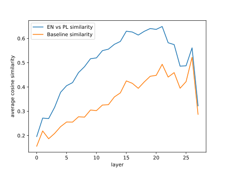
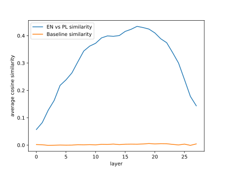

# Touching the Divine Part 2: Language Divergence

_This is the second part of a series about messing with LLM internals; Read
[the previous part](residuals_1_intro.html) first._

The point of this exercise is to experimentally verify the intuition that
the kind of natural language the prompt is formulated in does not matter
in the depths of an LLM, because internal layers of the model deal with 
abstract _concepts_ and not specific _words_. We'll check that by comparing
the internal representations of the same set of prompts in two natural languages,
Polish and English.

## Hypothesis

Take the same prompt written in two different languages:

* English: "Modern space telescopes equipped with sensitive infrared
  detectors allow astronomers to"
* Polish: "Nowoczesne teleskopy kosmiczne wyposażone w czułe detektory
  podczerwieni umożliwiają astronomom"

Processing these prompts will result in two distinct residual streams 
(for the last prompt token):

$x_1, x_2, ..., x_n$

$y_1, y_2, ..., y_n$

We'll be calculating cosine similarity between various residual vectors,
so from this point on assume they were normalized (all are of length 1).

The per-layer cosine similarity $x_1^Ty_1, x_2^Ty_2, ..., x_n^Ty_n$ between the
residual streams of the same prompt in different languages should be inverse-U 
shaped:

* In the first few layers, the LLM figures out the prompt structure, which differs
  between languages → low similarity
* In most of the internal layers, the LLM operates on the prompt _meaning_,
  which is the same in both languages → high similarity 
* In the output layers, the LLM calculates the probabilities for the first
  generated token → low similarity

## Experiment

The sections below document the experiment in detail. I won't publish the 
exact code because:

* I have better things to do than cleaning up the jupyter notebook with the
  experiment.
* Instructions in the sections below are enough to reproduce the result, 
  just ask your friendly AI agent.
* If you want to actually learn this stuff you should implement it yourself 
  anyway.

### Data

The per-layer similarity for a single pair of prompts will likely be too noisy
to observe the language divergence effect, so I ran the experiment on 265
sentences and averaged the results.

The sentences I used came straight from a more powerful LLM. A bunch of examples:

* Polish
  1. Nowoczesne teleskopy kosmiczne wyposażone w czułe detektory
     podczerwieni umożliwiają astronomom
  2. Bakterie żyjące w pobliżu kominów hydrotermalnych na dnie oceanu
  3. Współczesna epistemologia bada fundamentalne granice ludzkiego
     poznania oraz
  4. Budowa średniowiecznych katedr gotyckich wymagała niezwykłej
  5. Zjawisko nadprzewodnictwa wysokotemperaturowego otwiera perspektywy
     dla bezstratnego
* English
  1. Modern space telescopes equipped with sensitive infrared detectors
     allow astronomers to
  2. Bacteria living near hydrothermal vents on the ocean floor
  3. Contemporary epistemology investigates the fundamental limits of human
     cognition and
  4. The construction of medieval Gothic cathedrals required extraordinary
  5. The phenomenon of high-temperature superconductivity opens prospects
     for lossless
   
The sentences are cut in half for three reasons:

* To make the experiment shorter. My MacBook Air M4 is not exactly an AI
  workstation.
* To avoid every sentence in both languages ending with the exact same token
  (a period `.`). Because we only inspect the residual stream of the final token,
  ending every prompt with a period would artificially inflate early layer
  similarity and add noise in deeper layers.
* To help the really dumb model I used produce clear residuals. The
  completion is more obvious if the sentence is broken in the middle
  instead of being complete, compare:
    * "Modern space telescopes equipped with sensitive infrared detectors
      allow astronomers to" → you can probably guess what's coming next.
    * "Modern space telescopes equipped with sensitive infrared detectors
      allow astronomers to see through clouds of dust." → the sentence is
      complete, hard to tell what the next sentence will be.

### Baseline

Let's say that the cosine similarity between 2000-dimensional unit vectors
is 0.08. Is that a lot? If you, like me, have spent all of your life in 
humble 3 dimensions you probably don't have intuitions about that, so we
need a baseline to compare the similarities against.

The residual comparison machinery can be used to establish such a
baseline. At any given layer, let $u_1, u_2, ..., u_m$ and $v_1, v_2, ..., v_m$
be the normalized residuals across all $m = 265$ English and Polish prompts.
If we take a random permutation $\sigma$ of $\{1, ..., m\}$, then
$u_1^Tv_{\sigma(1)}, u_2^Tv_{\sigma(2)}, ..., u_m^Tv_{\sigma(m)}$
compares _random_ pairs of prompts at that layer. Repeating this across all
layers gives us the baseline we need to judge whether the similarities we'll see
are significant or just random noise.

### Model

Because of the constrained compute I have, I decided to run this experiment 
on a really dumb 1.5B parameter model: `mlx-community/Qwen2.5-1.5B-4bit`
(28 layers, 1536-dimensional residual stream). This particular LLM has the
following useful characteristics:

* Already converted to work nicely with MLX, the ML framework from Apple 
  optimized for their hardware (more on that below).
* So small that even my laptop can process multi-prompt batches quickly.
* Not trained for instruction following. There's no chat template, no special
  tokens, etc. It just tries to complete whatever the prompt was.

### Inference

To run this experiment I needed a program that takes the data + model weights
and produces the per-language residuals to compare. At first I tried
Huggingface `transformers` with residuals dumped via `output_hidden_states=True`,
but it decided to start the process by dequantizing the model from 4 to 16 bit 
to ensure no RAM stays empty, so I pivoted to using [MLX][mlx] directly.

MLX does not have an easy-to-use equivalent of `output_hidden_states=True`, so
I had to undertake a tiny side quest of writing the forward pass by hand. Since
we only need the _prefill_ stage (no autoregressive token generation loop
required), it turned out to be just a few lines of code: embed the input tokens,
loop over `model.model.layers` with a causal mask, and record the last-token
vector after each layer.

[mlx]: https://opensource.apple.com/projects/mlx/

## Results

### First Attempt

When I ran my experiment for the first time, I got this unimpressive result:

The baseline looks all wrong! Why would the similarity between residuals for
random pairs of prompts grow with the layer number?

Turns out LLMs are extremely _anisotropic_: they project concepts into a very
narrow cone, so if not centered, all residual vectors end up similar, regardless
of what the prompt was, which explains the bizarre observed baseline behavior.

Once you know this, which took me a long while to figure out, the fix is easy:
calculate the mean English and Polish residual at each layer, and subtract it from
all residuals for prompts in the corresponding language before vector
normalization.

### Second Attempt

Once the residuals were centered and normalized, the results formed the beautiful
curve below:

This exactly matches our initial hypothesis!

Have we done it? Have we peeked inside the mind of the proto-machine-god? This is
a very basic exercise, but it clearly shows that it's possible to reason about
simple LLM internals, formulate hypotheses and then check them experimentally,
as if LLMs were one of many normal technologies and not some alien species
we conjured into being on a GPU...

## Implementation Notes

* MLX is super pleasant to work with, and conceptually compatible with Jax if
  some actual heavy-lifting is needed.
* MLX framework seamlessly integrates with huggingface, so loading a model and
  tokenizer is a single line of code.
* By default huggingface will always phone home each time you load a model or
  a dataset, even if what you need is already cached locally. Setting
  `HF_HUB_OFFLINE=1` in the environment disables this little bit of additional
  surveillance.
* LLMs are no longer random when you sample with `argmax` (temperature = 0), so
  it's actually pretty easy to write unit tests for inference.
* Don't think how to make progress bars, just use `tqdm`. 